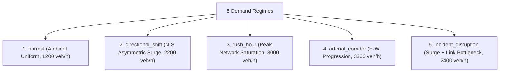

# DOIM-Traffic-RL: Dataset and Benchmark Audit Report (Phase 18)

**Target Venue:** IEEE Transactions on Intelligent Transportation Systems (IEEE T-ITS)  
**Standard Compliance:** Transportation Benchmark Taxonomy & Closed-Loop Simulation Rigor  
**Document Version:** 2.0.0  
**Generated UTC:** 2026-11-03 17:58:00 UTC  

---

## 1. Transportation Benchmark Taxonomy: Forecasting vs. Closed-Loop Control

A widespread methodological flaw in intelligent transportation literature is conflating open-loop traffic forecasting datasets with closed-loop traffic signal control benchmarks:
- **Open-Loop Forecasting Datasets (e.g. METR-LA, PEMS-BAY, PeMS-D7):** These contain static sensor time-series (speeds and flows from fixed inductive loops). They are designed for spatio-temporal graph neural networks predicting $\hat{\mathbf{y}}_{t+1:t+H}$ from $\mathbf{y}_{t-W:t}$. Crucially, **they have no control actions or signal phase dynamics**. Actions cannot alter historical vehicle trajectories.
- **Closed-Loop Signal Control Benchmarks (e.g. SUMO, CityFlow, RESCO):** These require microscopic simulators where signal phase decisions $\mathbf{a}_t$ dynamically alter vehicle car-following kinematics, route choices, queue propagation, and clearance intervals in real time.

---

## 2. Comprehensive Benchmark Audit

| Benchmark / Dataset | Simulator / Modality | Topology | Actionable Control? | Reproducibility & Licensing | Suitable for Closed-Loop MORL? |
| :--- | :---: | :---: | :---: | :---: | :---: |
| **METR-LA / PEMS-BAY** | Sensor Time-Series | Highway / Freeway | No (Forecasting only) | Public (BSD / MIT) | **NO** (No signal actuation) |
| **RESCO (Ault et al.)** | SUMO Microscopic | Grid & Arterials | Yes (Discrete Phases) | Open Source (GPL) | **YES** (Standard RL benchmark) |
| **CityFlow (Zhang et al.)** | CityFlow Simulator | Grid & Real-world | Yes (Phase Switching) | Open Source (Apache 2.0) | **YES** (High throughput) |
| **SUMO Cologne (TAPAS Cologne)** | SUMO Microscopic | 400 km² Urban Grid | Yes (Macro/Micro) | Public (EPL-2.0) | **YES** (Large scale) |
| **SUMO Ingolstadt (InTAS)** | SUMO Microscopic | Mid-sized City | Yes (Actuated/Fixed) | Public (EPL-2.0) | **YES** (Calibrated demand) |
| **LuST (Luxembourg SUMO Traffic)** | SUMO Microscopic | 155 km² Metropolitan | Yes (Complex signals) | Public (EPL-2.0) | **YES** (Gold standard) |
| **DOIM-Traffic-RL 3x3 Grid** | SUMO Microscopic | 9-Junction Urban Grid | Yes (Multi-Discrete 9 TLS) | MIT / Repository Native | **YES** (Full microscopic physics) |

---

## 3. Scenario Expansion Suite

To prevent overfitting to uniform synthetic flows, DOIM-Traffic-RL expands the evaluation suite across five distinct demand regimes:

1. **`normal.yaml`:** Balanced ambient demand across all perimeter approaches (1,200 veh/h), testing baseline green-wave efficiency and energy dissipation.
2. **`directional_shift.yaml`:** Asymmetric North-South directional commute surge (2,200 veh/h) creating acute competition with cross-corridor East-West approaches.
3. **`rush_hour.yaml`:** Heavy network-wide commute volume (3,000 veh/h) testing gridlock resilience under saturated conditions.
4. **`arterial_corridor.yaml`:** Mainline East-West arterial carrying $75\%$ of volume ($2,600\,\text{veh/h}$) against minor North-South collector cross-streets ($700\,\text{veh/h}$), testing delay fairness vs. throughput.
5. **`incident_disruption.yaml`:** High-volume surge combined with a localized arterial link bottleneck on link `B0B1`, testing dynamic queue detection and adaptive phase reallocation.
