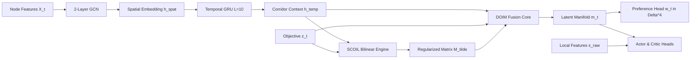

# DOIM-Traffic-RL: Final Mathematical Formulation and Architectural Specification (Phase 15)

**Target Venue:** IEEE Transactions on Intelligent Transportation Systems (IEEE T-ITS)  
**Standard Compliance:** Strict Mathematical Rigor & Differential Geometry Standards  
**Document Version:** 2.0.0  
**Generated UTC:** 2026-11-03 17:52:00 UTC  

---

## 1. Formal Mathematical Problem Definition

Urban traffic signal control across $N_c$ signalized intersections is formulated as a Constrained Multi-Objective Markov Decision Process (CMDP):
$$\mathcal{M}_{\text{traffic}} = \langle \mathcal{S}, \mathcal{A}, \mathcal{P}, \mathbf{R}, \mathcal{C}, \gamma \rangle$$

### 1.1 State Space $\mathcal{S}$
At each control step $t \in \{1, \dots, T\}$, the network state is defined on a directed traffic graph $\mathcal{G} = (\mathcal{V}, \mathcal{E})$, where $\mathcal{V} = \{1, \dots, N_c\}$ represents the signalized junctions and $\mathcal{E} \subseteq \mathcal{V} \times \mathcal{V}$ denotes the arterial corridor links.
The raw state $s_t = (\mathbf{X}_t, \mathbf{A}, \mathbf{z}_t, \boldsymbol{\psi}_t)$ consists of:
1. **Node Feature Matrix $\mathbf{X}_t \in \mathbb{R}^{|\mathcal{V}| \times d_{\text{node}}}$:** For each junction $i \in \mathcal{V}$, features include per-lane queue lengths, vehicle counts, average approach speeds, and active phase occupancy.
2. **Topological Adjacency $\mathbf{A} \in \{0, 1\}^{|\mathcal{V}| \times |\mathcal{V}|}$:** Unweighted graph connectivity reflecting physical roadway links.
3. **Normalized Objective Vector $\mathbf{z}_t \in [0, 1]^K$:** Current realization across $K=5$ normalized performance criteria.
4. **Signal Phase Status $\boldsymbol{\psi}_t \in \mathbb{N}^{|\mathcal{V}| \times 2}$:** Active phase index and elapsed duration in seconds $(p_{i,t}, t_{\text{active}, i, t})$ for each controller.

### 1.2 Action Space $\mathcal{A}$
The control policy operates over a multi-discrete action space $\mathcal{A} = \prod_{j=1}^{N_c} \{0, 1\}$, where $a_{j,t} \in \{0, 1\}$ represents the candidate transition decision for intersection $j$:
- $a_{j,t} = 0$: Extend the currently active signal phase.
- $a_{j,t} = 1$: Request a phase transition to the next sequential signal phase in the ring plan.

### 1.3 Multi-Objective Cost Vector $\mathbf{z}_t$
The multi-objective reward is defined as the negative normalized cost vector $\mathbf{R}(s_t, \mathbf{a}_t) = - \mathbf{z}_t \in [-1, 0]^K$, tracking five competing traffic criteria:
1. **$z_{1,t}$ (Vehicular Delay):** Cumulative stopped delay across all approaches, normalized by network saturation bounds.
2. **$z_{2,t}$ (Queue Length):** Total number of halted vehicles ($v < 0.1\,\text{m/s}$) across all inbound lanes.
3. **$z_{3,t}$ ($\text{CO}_2$ Emissions):** Total instantaneous carbon dioxide emissions calculated via the microscopic HBEFA emission model.
4. **$z_{4,t}$ (Throughput Deficit):** Normalized shortfall from maximum roadway capacity, $z_{4,t} = 1.0 - \min(1.0, \frac{\text{completed\_vehicles}_t}{\text{capacity}_{\max}})$.
5. **$z_{5,t}$ (Fairness Disparity):** Arterial approach disparity $1.0 - \mathcal{J}_t$, where $\mathcal{J}_t \in [0, 1]$ is Jain's fairness index over directional approach delays.

---

## 2. Differential Geometry of DOIM

### 2.1 The Interaction Manifold $\mathcal{M}_{\text{int}}$
**Definition 1 (Interaction Manifold):** The objective interaction manifold $\mathcal{M}_{\text{int}}$ is defined as the smooth embedded submanifold of $\mathbb{R}^{K \times K}$:
$$\mathcal{M}_{\text{int}} = \left\{ \mathbf{M} \in \mathbb{R}^{K \times K} \;\middle|\; M_{kk} = 1.0 \;\; \forall k \in \{1, \dots, K\}, \;\; |M_{ij}| < 1.0 \;\; \forall i \neq j \right\}$$

- **Manifold Properties:**
  1. $\mathcal{M}_{\text{int}}$ is an open, bounded smooth manifold of dimension $\dim(\mathcal{M}_{\text{int}}) = K(K - 1) = 20$.
  2. The identity self-interaction condition $M_{kk} = 1.0$ reflects that any objective maximally co-varies with itself.
  3. Off-diagonal elements $M_{ij} \in (-1, 1)$ quantify asymmetric, directional cross-sensitivity: $M_{ij} > 0$ denotes mutual synergy (improving objective $j$ simultaneously improves objective $i$), whereas $M_{ij} < 0$ denotes acute trade-off (improving objective $j$ degrades objective $i$).
  4. The tangent space at any point $\mathbf{M} \in \mathcal{M}_{\text{int}}$ is:
     $$T_{\mathbf{M}} \mathcal{M}_{\text{int}} = \left\{ \mathbf{V} \in \mathbb{R}^{K \times K} \;\middle|\; V_{kk} = 0 \;\; \forall k \in \{1, \dots, K\} \right\} \cong \mathbb{R}^{K(K-1)}$$
  5. The smooth retraction map $\Pi_{\mathcal{M}}: \mathbb{R}^{K \times K} \to \mathcal{M}_{\text{int}}$ is:
     $$\Pi_{\mathcal{M}}(\mathbf{X})_{ij} = \begin{cases} 1.0, & i = j \\ \tanh(X_{ij}), & i \neq j \end{cases}$$
     ensuring strictly positive gradient flow: $\frac{\partial}{\partial X_{ij}} \Pi_{\mathcal{M}}(\mathbf{X})_{ij} = 1 - \tanh^2(X_{ij}) > 0$ for all $i \ne j$.

### 2.2 The Objective Preference Simplex $\Delta^{K-1}$
**Definition 2 (Preference Simplex):** The adaptive preference space is the open $(K-1)$-simplex:
$$\Delta^{K-1} = \left\{ \mathbf{w} \in \mathbb{R}_+^K \;\middle|\; \sum_{k=1}^K w_k = 1, \; w_k > 0 \;\; \forall k \in \{1, \dots, K\} \right\}$$

Under the Fisher-Rao information metric, $\Delta^{K-1}$ is a Riemannian manifold of constant positive curvature. The geodesic distance between preference vectors $\mathbf{w}, \mathbf{w}' \in \Delta^{K-1}$ is given by:
$$d_{\text{FR}}(\mathbf{w}, \mathbf{w}') = 2 \arccos\left( \sum_{k=1}^K \sqrt{w_k w'_k} \right)$$
The temperature-scaled softmax mapping $\sigma_\tau: \mathbb{R}^K \to \Delta^{K-1}$ acts as the Riemannian exponential map on the multinomial logit manifold:
$$\mathbf{w} = \sigma_\tau(\mathbf{v}) = \frac{\exp(v_k / \tau)}{\sum_{j=1}^K \exp(v_j / \tau)}$$

---

## 3. End-to-End Architecture: GCN-GRU-SCOIL-DOIM

The complete forward pipeline is structured as follows:

### 3.1 Spatial GCN Encoder
$$\mathbf{H}_t^{(1)} = \text{ReLU}\left( \mathbf{\tilde{D}}^{-\frac{1}{2}} \mathbf{\tilde{A}} \mathbf{\tilde{D}}^{-\frac{1}{2}} \mathbf{X}_t \mathbf{\Theta}_{\text{gcn}}^{(1)} \right)$$
$$\mathbf{H}_t^{(2)} = \mathbf{\tilde{D}}^{-\frac{1}{2}} \mathbf{\tilde{A}} \mathbf{\tilde{D}}^{-\frac{1}{2}} \mathbf{H}_t^{(1)} \mathbf{\Theta}_{\text{gcn}}^{(2)}$$
$$\mathbf{h}_t^{\text{spat}} = \frac{1}{|\mathcal{V}|} \sum_{i=1}^{|\mathcal{V}|} \mathbf{h}_{i,t}^{(2)} \in \mathbb{R}^{d_{\text{spat}}}$$

### 3.2 Temporal GRU Encoder
$$\mathbf{h}_t^{\text{temp}} = \text{GRU}\left( [\mathbf{h}_{t-L+1}^{\text{spat}}, \dots, \mathbf{h}_t^{\text{spat}}] \right) \in \mathbb{R}^{d_{\text{temp}}}$$
with historical window $L = 10$, causal zero-padding at episode initialization, and zero inter-episode bleeding.

### 3.3 SCOIL Bilinear Operator & Uncertainty Shrinkage
Let $\mathbf{c}_t = [\mathbf{h}_t^{\text{temp}} \parallel \mathbf{z}_t]$:
$$\mathbf{Q}_t = \mathbf{W}_Q \phi(\mathbf{c}_t), \quad \mathbf{K}_t = \mathbf{W}_K \phi(\mathbf{c}_t)$$
$$\mathbf{M}_t^{\text{raw}} = \frac{\mathbf{Q}_t \mathbf{K}_t^\top}{\sqrt{d_k}} + \text{reshape}(\mathbf{W}_{\text{asym}}\phi(\mathbf{c}_t), [K, K])$$
$$\mathbf{M}_t = \Pi_{\mathcal{M}}(\mathbf{M}_t^{\text{raw}}) \in \mathcal{M}_{\text{int}}$$

Predictive dispersion scores $\mathbf{U}_t \in \mathbb{R}_+^{K \times K}$ (with $U_{kk} = 0$) provide adaptive shrinkage towards an uncoupled conservative prior $\mathbf{M}_0 = \mathbf{I}$:
$$\mathbf{w}_{\text{shrink}, t} = \frac{1}{1 + \lambda_{\text{shrink}} \mathbf{U}_t}$$
$$\mathbf{\tilde{M}}_t = \mathbf{w}_{\text{shrink}, t} \odot \mathbf{M}_t + (1 - \mathbf{w}_{\text{shrink}, t}) \odot \mathbf{M}_0$$

---

## 4. Interaction-Aware Multi-Objective PPO (IA-MOPPO)

### 4.1 Surrogate Objective & Action Attribution
The policy gradient surrogate loss evaluates proposed candidate actions $\mathbf{a}_t^{\text{prop}} \sim \pi_\theta$:
$$\mathcal{L}_{\text{PPO}}(\theta) = -\hat{\mathbb{E}}_t \left[ \min\left( r_t(\theta) \hat{A}_t, \text{clip}(r_t(\theta), 1-\epsilon, 1+\epsilon) \hat{A}_t \right) \right]$$
where $r_t(\theta) = \frac{\pi_\theta(\mathbf{a}_t^{\text{prop}} \mid s_t)}{\pi_{\theta_{\text{old}}}(\mathbf{a}_t^{\text{prop}} \mid s_t)}$, and $\hat{A}_t$ is computed via GAE on scalarized rewards $R_t = - \mathbf{w}_t^\top \mathbf{z}_t$.

### 4.2 Auxiliary Dynamics Loss with Executed Actions
The auxiliary transition model and SCOIL are trained exclusively on executed actions $\mathbf{a}_t^{\text{exec}}$ filtered by the safety shield:
$$\hat{\mathbf{z}}_{t+1} = \text{clip}\left( \mathbf{z}_t + \mathbf{\tilde{M}}_t (\mathbf{W}_a \mathbf{a}_t^{\text{exec}}), 0.0, 1.0 \right)$$
$$\mathcal{L}_{\text{scoil}} = \frac{1}{2} \sum_{k=1}^K \left[ \frac{(\hat{z}_{k,t+1} - z_{k,t+1})^2}{\sigma_{k,t}^2 + \epsilon} + \log(\sigma_{k,t}^2 + \epsilon) \right]$$
where $\sigma_{k,t}^2 = \frac{1}{K} \sum_j U_{t, kj} + \epsilon$.

This formal separation guarantees that policy exploration is not penalized by shield overrides, while transition dynamics learn actual macroscopic traffic responses.
