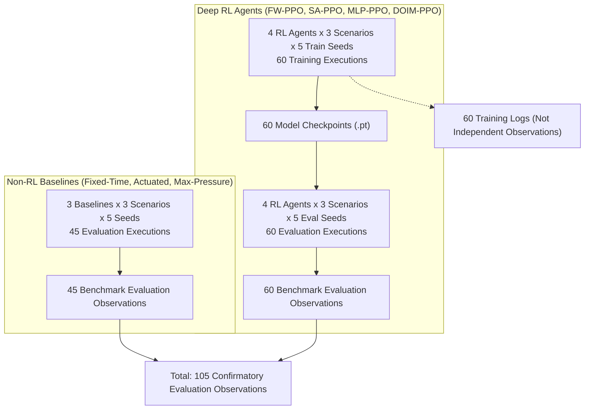

# Phase 28.2.1: Execution Accounting & Seed-Pairing Specification
**Project:** DOIM-PPO (*Learning Dynamic Objective Interaction Manifolds for Adaptive Multi-Objective Deep Reinforcement Learning in Real-Time Traffic Systems*)  
**Target Venue:** IEEE Transactions on Intelligent Transportation Systems (IEEE T-ITS)  
**Standard:** Artifact-to-Observation Traceability & Independence Invariants  
**Auditing Panel:** Independent Research Validation Team  
**Date:** November 3, 2026  

---

## 1. Disentangling 105 Observations from 165 Physical Executions

In scientific benchmarks involving reinforcement learning, training runs and evaluation runs produce distinct physical execution artifacts. To eliminate ambiguity in statistical reporting:

### 1.1 Complete Physical Execution Ledger
1. **60 RL Training Executions:** 4 RL algorithms $\times$ 3 scenarios $\times$ 5 training seeds ($s_{\text{train}} \in \{42, 43, 44, 45, 46\}$).
   - *Artifacts Produced:* 60 trained PyTorch model checkpoints (`model.pt`) and training logs.
   - *Statistical Status:* **Parameter generation artifacts.** Not counted as benchmark evaluation observations.
2. **60 RL Evaluation Executions:** 4 RL algorithms $\times$ 3 scenarios $\times$ 5 held-out evaluation seeds ($s_{\text{eval}} \in \{1042, 1043, 1044, 1045, 1046\}$).
   - *Artifacts Produced:* 60 deterministic evaluation records (`metrics_step.csv`, `summary.json`).
   - *Statistical Status:* **60 independent benchmark observations.**
3. **45 Non-RL Evaluation Executions:** 3 non-RL algorithms $\times$ 3 scenarios $\times$ 5 held-out evaluation seeds ($s_{\text{eval}} \in \{1042, 1043, 1044, 1045, 1046\}$).
   - *Artifacts Produced:* 45 deterministic evaluation records (`metrics_step.csv`, `summary.json`).
   - *Statistical Status:* **45 independent benchmark observations.**

$$\mathbf{Total\,Physical\,Executions = 60 + 60 + 45 = 165}$$
$$\mathbf{Total\,Benchmark\,Observations = 60 + 45 = 105}$$

---

## 2. Seed-Pairing & Scenario Assignment Mapping

To preserve strict pairing for Student's $t$-tests and Wilcoxon tests, seeds are mapped deterministically:

| Replicate ID ($k$) | Training Seed ($s_{\text{train}}$) | Held-Out Evaluation Seed ($s_{\text{eval}}$) | Traffic Demand Realization |
| :---: | :---: | :---: | :---: |
| **Seed Block 1** | $42$ | $1042$ | Uniform stochastic trip distribution #1 |
| **Seed Block 2** | $43$ | $1043$ | Uniform stochastic trip distribution #2 |
| **Seed Block 3** | $44$ | $1044$ | Uniform stochastic trip distribution #3 |
| **Seed Block 4** | $45$ | $1045$ | Uniform stochastic trip distribution #4 |
| **Seed Block 5** | $46$ | $1046$ | Uniform stochastic trip distribution #5 |

### Independence Rules:
- Training seed $s_{\text{train}}$ is strictly quarantined from evaluation seed $s_{\text{eval}}$ ($s_{\text{eval}} = s_{\text{train}} + 1000$).
- All 7 algorithms in Replicate $k$ encounter the **exact same SUMO vehicle trip file and route generation sequence** (Seed $1042 + k - 1$).
